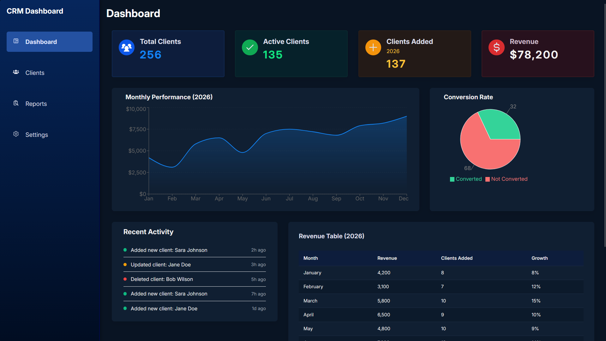
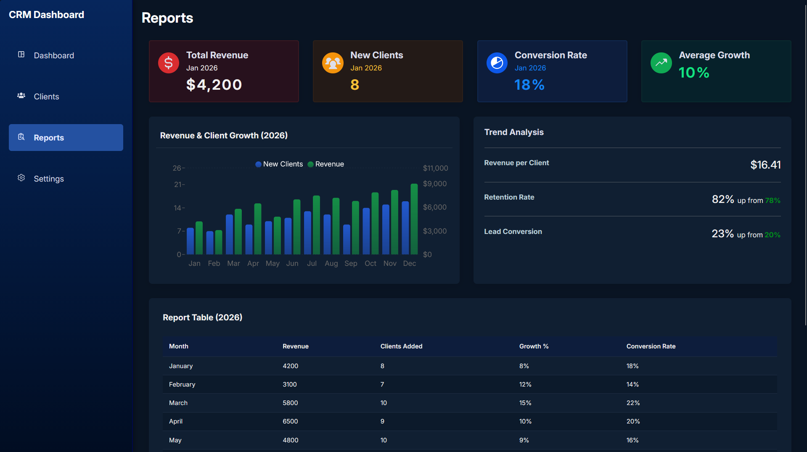
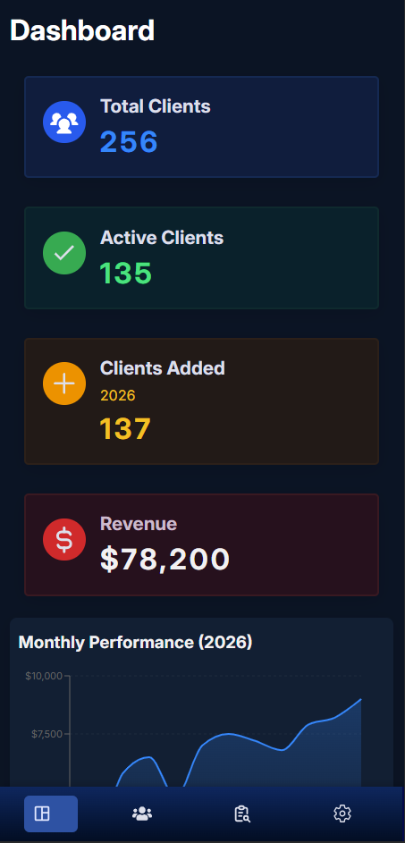
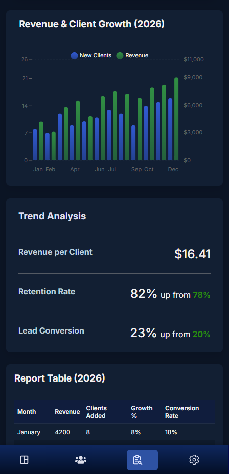

# CRM Dashboard

A React dashboard for managing clients, tracking revenue, and viewing reports, with light and dark themes.

**Live demo:** https://fixedbits.github.io/client-dashboard/





<p align="center">
  
  &nbsp;&nbsp;&nbsp;&nbsp;
  
</p>

## Features

- Add, edit, and delete clients, with form validation for name, email, and company
- Live Recent Activity feed that logs every add, update, and delete
- Reports page with KPI cards, a dual-axis bar chart, a trend analysis panel, and a data table
- Interactive revenue charts with formatted tooltips and axes
- Dark mode toggle in Settings, remembered between visits
- Client list and activity feed saved to `localStorage`, with a reset option
- Fully responsive layout: charts resize, and tables turn into stacked cards on phones

## Tech Stack

- React with Vite
- React Router (HashRouter)
- Recharts
- Plain CSS with theme variables for light and dark mode
- Deployed with GitHub Pages

## Run Locally

```
git clone https://github.com/FixedBits/client-dashboard.git
cd client-dashboard
npm install
npm run dev
```

## Notes

This is a front-end project. It starts with sample data from local files, and changes are saved in the browser with `localStorage`. A Node, Express, and MongoDB backend is planned as a future step.
